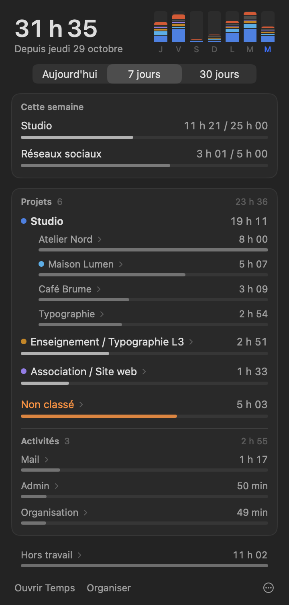
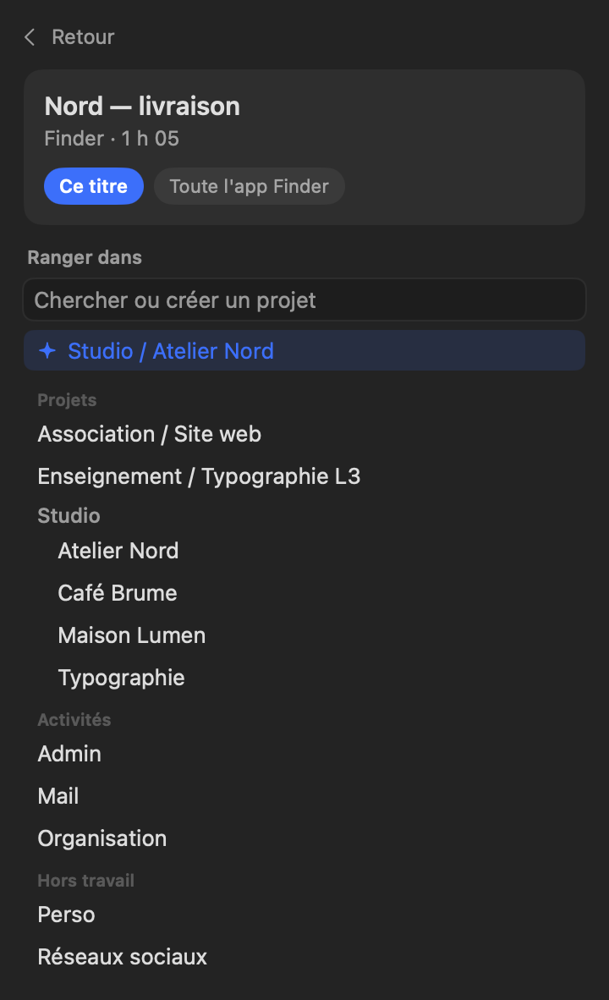
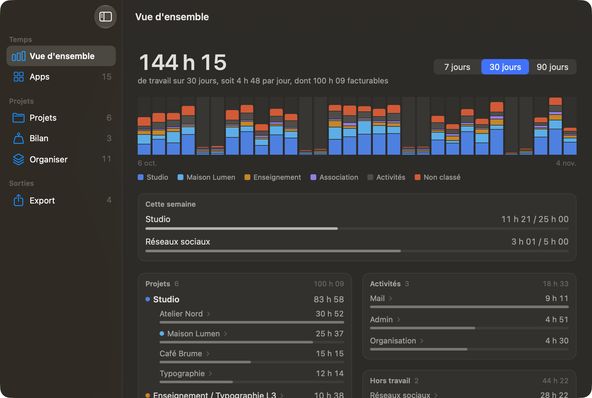
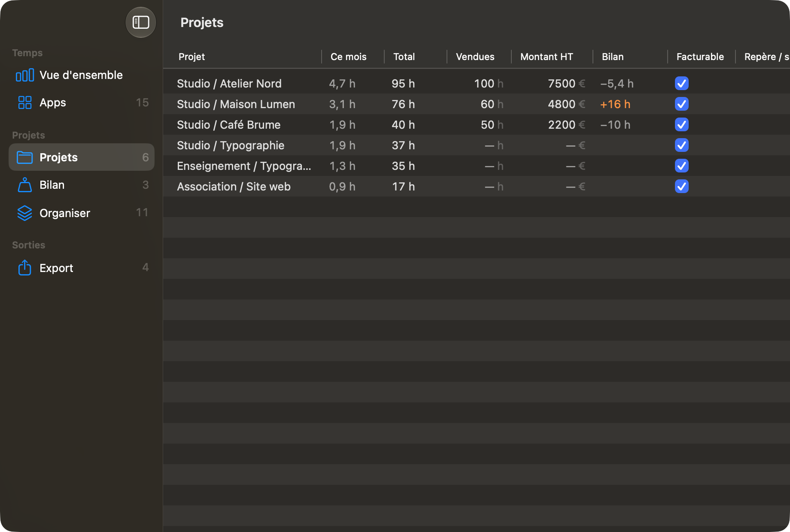
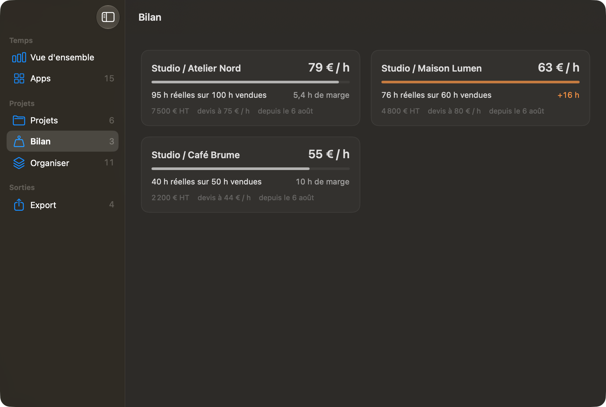
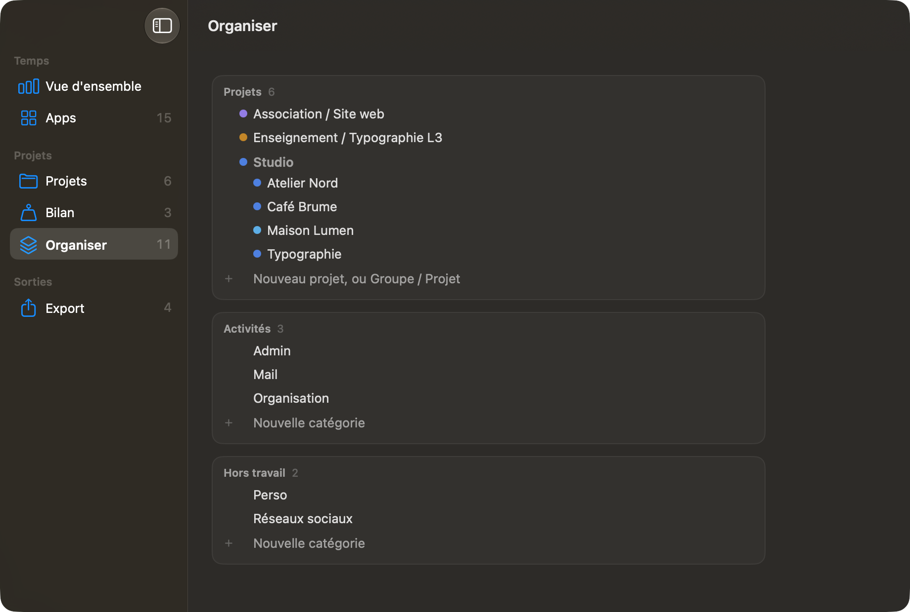

# Temps

[English](README.md) · **Français**

Temps est une petite app pour macOS qui note ce que fait ton Mac et en déduit le temps passé sur chacun de tes projets. Il n'y a pas de minuteur à lancer ni rien à saisir : elle regarde l'app au premier plan, le fichier ou le site ouvert, et range tout ça au bon endroit. Elle sait aussi lire le temps d'écran de l'iPhone et de l'iPad quand il est partagé avec le Mac. Et rien ne quitte ta machine.



Je l'ai faite pour moi, comme graphiste indépendant. Je voulais savoir combien de temps je passe vraiment sur un client, le comparer à ce que j'ai vendu dans le devis, et voir en deux secondes où est partie ma semaine. Le principe, c'est que tout ce qui est rangé dans tes dossiers de projets se classe tout seul. Le reste, tu le classes une fois d'un clic, et Temps s'en souvient.

## Au quotidien

Dans la barre des menus, tu as le total de travail de la journée. Un clic ouvre un panneau avec les sept derniers jours en barres colorées par groupe de projets (un clic sur une barre affiche ce jour-là), tes repères de la semaine, puis le temps passé sur chaque projet. Chaque ligne se déplie pour montrer ce qu'il y a dedans : des fichiers, des sites, des messages…

Le temps non classé est en orange, parce que c'est le seul endroit où il y a quelque chose à faire. Tu cliques sur une ligne, tu choisis jusqu'où va la règle (ce site ou tout le domaine, ce correspondant ou toute sa boîte, ou toute l'app), puis le projet. S'il n'existe pas encore, tu tapes son nom et il est créé. La règle vaut aussi pour tout l'historique, et une barre « Annuler » reste affichée quelques secondes si tu t'es trompé.



Pour aller plus vite, Temps fait des suggestions à partir de ce que tu as déjà classé : un site, un titre ou un mot qui mène presque toujours au même projet. Un bouton les accepte toutes d'un coup (et une seule annulation les retire). Il n'y a pas d'IA là-dedans, juste du calcul sur ton Mac.

## La fenêtre

« Ouvrir Temps » ouvre une vraie fenêtre. La vue d'ensemble montre 7, 30 ou 90 jours, avec la part facturable de la période.



Dans Projets, tu remplis directement le tableau : les heures vendues, le montant du devis, si c'est facturable, et un objectif d'heures par semaine si tu veux. La colonne Bilan te dit tout de suite s'il te reste de la marge ou si tu as dépassé.



Bilan reprend ça projet par projet, avec le taux horaire réel à côté de celui du devis. C'est souvent là qu'on comprend pourquoi un projet a été pénible.



Organiser regroupe toutes les catégories en trois familles : projets, activités (mail, admin…) et hors travail. Tu glisses une catégorie sur une famille pour l'y ranger, ou sur une autre catégorie pour en faire un sous-projet. Double-clic pour renommer, clic sur une pastille pour changer la couleur (d'un groupe entier, ou d'un seul client dans les nuances de son groupe), clic droit pour le reste.



Il y a aussi une liste du temps par app, avec la catégorie où chacune passe le plus de temps, et un export CSV par mois pour Numbers ou Excel.

## Ce que Temps regarde

Toutes les 10 secondes, il note l'app au premier plan, le titre de la fenêtre et, quand c'est possible, le détail de ce que tu y fais : le fichier ouvert, la page web, le message lu, la note ou la tâche sélectionnée. Ce détail dépend de chaque app, et celles qui ne donnent ni fichier ni titre apparaissent seulement sous leur nom.

Après deux minutes sans toucher le clavier ni la souris, il retire toute la période de pause (sauf si une vidéo ou une visio tourne). Les fichiers rangés dans un dossier de projets sont classés d'office : `Studio/Clients/Dupont/maquette.indd` devient « Studio / Dupont ». Le temps passé sur l'iPhone et l'iPad compte en hors travail tant que tu n'as rien classé, et le chiffre de la barre des menus ne compte que le travail.

## Installation

Il te faut macOS 14 ou plus récent, Python 3.11 ou plus récent (celui de [python.org](https://www.python.org/downloads/macos/) ou de Homebrew), et les outils en ligne de commande de Xcode (`xcode-select --install`).

```bash
git clone https://github.com/viktorvuka/temps.git
cd temps
./macos/build.sh
open Temps.app
```

`Temps.app` apparaît dans le dossier. C'est l'interface, et c'est elle qui fait tourner en arrière-plan l'enregistreur et un petit serveur local sur 127.0.0.1:8230. Au premier lancement :

1. Dans Réglages Système > Confidentialité et sécurité > Accès complet au disque, ajoute `Temps.app`. Sans ça, Temps ne peut pas lire le temps d'écran.
2. macOS te demande ensuite l'Accessibilité et l'Automatisation pour plusieurs apps : accepte, c'est ce qui permet de lire la fenêtre et le fichier au premier plan.
3. Pour l'iPhone et l'iPad, active « Partager entre les appareils » dans Temps d'écran.

Si tu compiles ta propre version, donne-lui ton identifiant : `TEMPS_ID=com.exemple.temps ./macos/build.sh`. Attention, macOS redemande les accès à chaque recompilation. Pour l'éviter, signe l'app avec un certificat de ton trousseau (celui que Xcode crée avec un identifiant Apple gratuit suffit) : `TEMPS_SIGN="Apple Development: …" ./macos/build.sh`.

## Réglages

Au premier lancement, Temps crée `rules.toml` à côté du code, en copiant `rules.example.fr.toml`. L'app le modifie elle-même quand tu classes, renommes ou organises, mais tu peux aussi l'ouvrir et l'éditer à la main. La première chose à y mettre, ce sont tes dossiers de projets, dans `[dossiers]`.

| Section | À quoi elle sert |
|---|---|
| `[dossiers]` | Tes dossiers de projets (`racines`) et les dossiers-paniers à sauter (`intermediaires`, par exemple `Clients`). |
| `[familles]` | Ce qui compte comme activité ou comme hors travail. Tout le reste est un projet. |
| `[titres]`, `[apps]`, `[chemins]` | Les règles de classement : un texte dans un titre, une URL ou une adresse, une app, un début de chemin. |
| `[noms]`, `[alias]` | Le nom affiché d'une catégorie, et le lien quand tu as renommé un dossier. |
| `[projets]` | Les fiches : heures vendues, montant HT, facturable. |
| `[reperes]` | Les objectifs ou les plafonds de la semaine. |
| `[couleurs]` | La couleur d'un groupe ou d'un sous-projet. |

## Raccourcis

Quand la fenêtre est ouverte, Temps a son propre menu : ⌘1 à ⌘6 pour passer d'une rubrique à l'autre, ⌃⌘S pour la barre latérale, ⌘E pour exporter le mois en cours.

## Mode démo

Pour essayer sans tes données (ou faire des captures comme celles-ci), quitte Temps et relance-la avec `open Temps.app --args --demo`. Un studio imaginaire avec trois clients et un cours remplit les écrans, et ses règles sont rangées à part : elles ne touchent jamais aux tiennes.

## Confidentialité

Tout reste sur ton Mac. Les relevés sont dans `~/Library/Application Support/Temps/`, le serveur n'écoute que 127.0.0.1, et il n'y a ni compte, ni télémétrie, ni service extérieur.

## Ce qui reste fragile

Le temps d'écran vient de fichiers internes de macOS qui ne sont pas documentés : une mise à jour du système peut les changer, et il faudra alors adapter la lecture. Le moteur est en Python et l'interface en SwiftUI ; une version tout en Swift éviterait d'installer Python, mais elle n'existe pas encore.

## Licence

GPL v3. Tu peux utiliser Temps, le modifier et le redistribuer, à condition que les versions modifiées restent libres sous la même licence. Voir [LICENSE](LICENSE).
