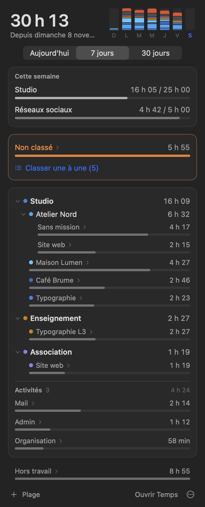
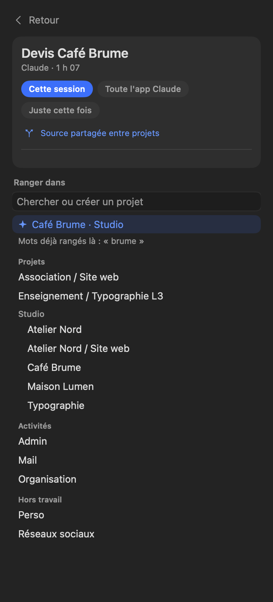
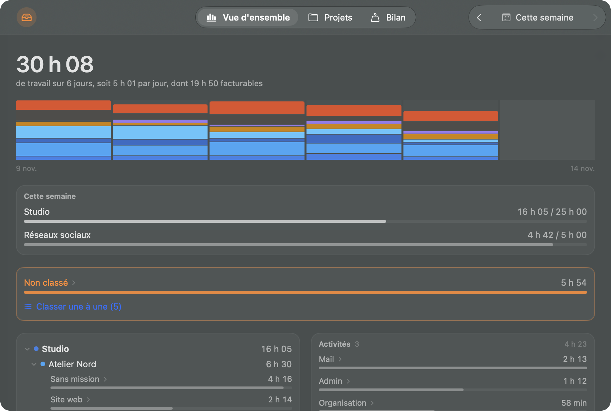
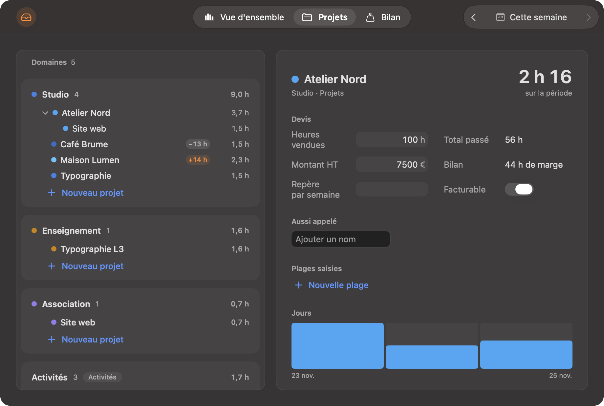
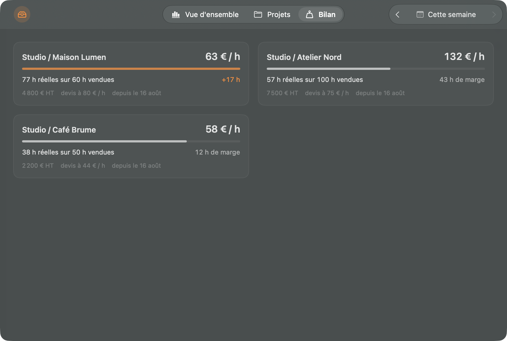

# Temps

[English](README.md) · **Français**

Temps est une petite app pour macOS qui note ce que fait ton Mac et en déduit le temps passé sur chacun de tes projets. Il n'y a pas de minuteur à lancer ni rien à saisir : elle regarde l'app au premier plan, le fichier ou le site ouvert, et range tout ça au bon endroit. Elle sait aussi lire le temps d'écran de l'iPhone et de l'iPad quand il est partagé avec le Mac. Et rien ne quitte ta machine.



Je l'ai faite pour moi, comme graphiste indépendant. Je voulais savoir combien de temps je passe vraiment sur un client, le comparer à ce que j'ai vendu dans le devis, et voir en deux secondes où est partie ma semaine. Le principe, c'est que tout ce qui est rangé dans tes dossiers de projets se classe tout seul. Le reste, tu le classes une fois d'un clic, et Temps s'en souvient.

## Au quotidien

Dans la barre des menus, tu as le total de travail de la journée. Un clic ouvre un panneau avec le ruban de la journée, coloré par projet, où le non classé apparaît hachuré à l'heure où il s'est produit. Sur 7 jours, il laisse la place aux barres de la semaine, et sur 30 jours au calendrier du mois ; un clic sur un jour l'ouvre. En dessous viennent tes projets les plus longs, rangés sous leur domaine. Chaque ligne se déplie pour montrer ce qu'il y a dedans : des fichiers, des sites, des messages…

Le temps non classé est en orange, parce que c'est le seul endroit où il y a quelque chose à faire. Sa carte montre les premières sources avec leur suggestion : un clic (ou Entrée) l'accepte sans quitter le panneau. Pour le reste, tu cliques sur une ligne, tu choisis jusqu'où va la règle (ce site ou tout le domaine, ce correspondant ou toute sa boîte, toute l'app, ou juste cette fois, sans règle), puis le projet. Les détails, sous la ligne, montrent les titres de fenêtre, l'adresse et les moments, et la suggestion dit d'où elle vient. S'il n'existe pas encore, tu tapes son nom et il est créé. La règle vaut aussi pour tout l'historique, et une barre « Annuler » reste affichée quelques secondes si tu t'es trompé.



C'est le même écran partout où tu ranges quelque chose : une ligne du panneau ou de la fenêtre, déjà classée ou non, un créneau du ruban, un fichier dans la fiche d'un projet.

Un prestataire qui sert plusieurs clients (un imprimeur en ligne, une banque d'images) se marque comme source partagée : il ne reçoit jamais de règle, et prend le projet sur lequel tu travailles juste avant et juste après. S'il n'y en a qu'un d'un côté, Temps te le propose sans rien ranger.

Pour aller plus vite, Temps fait des suggestions à partir de ce que tu as déjà classé : un site, un titre ou un mot qui mène presque toujours au même projet. Un bouton les accepte toutes d'un coup (et une seule annulation les retire). Il n'y a pas d'IA là-dedans, juste du calcul sur ton Mac.

Le non classé a sa propre carte, en tête, juste sous les repères de la semaine. Si tu as laissé filer quelques jours, « Classer une à une » ouvre la rubrique À classer de la fenêtre : la liste des lignes à gauche, de la plus longue à la plus courte, et l'écran Classer à droite, avec la suggestion déjà prête. Entrée pour l'accepter, ⌘→ pour passer.

## La fenêtre

« Ouvrir Temps » ouvre une vraie fenêtre, avec trois vues en haut et la période à droite : aujourd'hui, hier, une semaine, un mois, un trimestre, une année, ou les dates que tu choisis dans le calendrier. Les flèches reculent ou avancent d'une période entière.

La vue d'ensemble montre le travail de la période jour par jour, la part facturable, tes repères de la semaine, puis une carte par domaine avec ses projets.



Sur un seul jour, l'histogramme laisse la place à un ruban coloré par projet, avec le détail au survol (un clic sur une barre de l'histogramme y mène aussi). Un clic droit sur un morceau du ruban le range dans un autre projet.

Projets range tout en trois niveaux : le domaine (Studio, Enseignement, une asso…), le projet, et la mission quand un client revient pour un nouveau chantier. Un domaine a une nature (projets, activités comme le mail ou l'admin, hors travail) et une couleur, et chacun de ses projets en prend une nuance.

À gauche, la liste. Tu y crées un domaine, un projet ou une mission, tu glisses un projet d'un domaine à l'autre, et tu renommes d'un double-clic. Le clic droit sert au reste : archiver un projet terminé (il sort des listes, son temps reste compté), fusionner deux projets, supprimer.

À droite, la fiche du projet choisi. Tu y remplis les heures vendues, le montant du devis, si c'est facturable, et un objectif d'heures par semaine si tu veux. Le bilan te dit tout de suite s'il te reste de la marge ou si tu as dépassé. En dessous vient le détail de la période : les jours, les apps, les fichiers, les sites et les sessions.



Une mission peut démarrer à une date : à partir de ce jour-là, le temps du projet va à elle. Et si un fichier ou un site s'est rangé au mauvais endroit, « Déplacer », au survol de sa ligne dans la fiche, l'envoie dans un autre projet.

Pour ce qui se passe loin du Mac (une réunion, un rendez-vous, une heure de croquis), « + Plage » ajoute un créneau à la main, depuis le panneau ou depuis la fiche d'un projet : le jour, l'heure de début, l'heure de fin et une note.

Bilan reprend les devis projet par projet, avec le taux horaire réel à côté de celui du devis. C'est souvent là qu'on comprend pourquoi un projet a été pénible.



Les Réglages (⌘,) montrent si Temps a bien ses accès, avec un bouton vers chaque volet de Réglages Système. On y trouve aussi l'ouverture au démarrage, un rappel le vendredi après-midi s'il reste plus de 2 h non classées dans la semaine, le récap de la semaine passée le lundi matin, l'export CSV d'un mois pour Numbers ou Excel, et la liste de toutes tes règles de classement, à corriger ou retirer sur place. Une option range les petits moments (deux minutes au plus dans la journée, que rien ne classe) avec le projet qui les entoure, quand il est là avant et après.

## Ce que Temps regarde

Toutes les 10 secondes, il note l'app au premier plan, le titre de la fenêtre et, quand c'est possible, le détail de ce que tu y fais : le fichier ouvert, la page web, le message lu, la note ou la tâche sélectionnée. Ce détail dépend de chaque app, et celles qui ne donnent ni fichier ni titre apparaissent seulement sous leur nom.

Après deux minutes sans toucher le clavier ni la souris, il retire toute la période de pause (sauf si une vidéo ou une visio tourne). Les fichiers rangés dans un dossier de projets sont classés d'office : `Studio/Clients/Dupont/maquette.indd` devient « Studio / Dupont ». Ailleurs sur le disque, un dossier qui porte le nom d'un de tes projets suffit : tout ce qu'il contient y va. Quand un projet porte un autre nom que son dossier (la marque d'un client, par exemple), ajoute le nom du client dans « Aussi appelé », sur sa fiche. Le temps passé sur l'iPhone et l'iPad compte en hors travail tant que tu n'as rien classé, et le chiffre de la barre des menus ne compte que le travail.

## Installation

### Le plus simple : l'app toute prête

Télécharge `Temps-1.4-macOS-arm64.zip` dans les [Releases](https://github.com/viktorvuka/temps/releases/latest), ouvre-le et range `Temps.app` dans Applications. Elle contient tout ce qu'il lui faut, Python compris : rien d'autre à installer. Il faut un Mac avec une puce Apple (M1 ou plus récent) et macOS 14 ou plus.

L'app n'est pas notarisée par Apple. Au premier lancement, macOS la bloque : va dans Réglages Système > Confidentialité et sécurité, descends jusqu'au message sur Temps et clique sur « Ouvrir quand même ». C'est à faire une seule fois. Ensuite, suis les trois étapes du premier lancement plus bas.

### Compiler soi-même

Il te faut macOS 14 ou plus récent, Python 3.11 ou plus récent (celui de [python.org](https://www.python.org/downloads/macos/) ou de Homebrew), et les outils en ligne de commande de Xcode (`xcode-select --install`).

```bash
git clone https://github.com/viktorvuka/temps.git
cd temps
./macos/build.sh
open Temps.app
```

`Temps.app` apparaît dans le dossier. `./macos/paquet.sh` fabrique en plus l'app toute prête, avec son propre Python, dans `dist/`.

### Au premier lancement

Temps.app est l'interface, et c'est elle qui fait tourner en arrière-plan l'enregistreur et un petit serveur local sur 127.0.0.1:8230.

Tant qu'un accès manque, le panneau s'ouvre sur la liste des trois accès, avec un bouton vers chaque volet de Réglages Système ; chaque ligne passe au vert dès que c'est fait.

1. Dans Réglages Système > Confidentialité et sécurité > Accès complet au disque, ajoute `Temps.app`. Sans ça, Temps ne peut pas lire le temps d'écran.
2. macOS te demande ensuite l'Accessibilité et l'Automatisation pour plusieurs apps : accepte, c'est ce qui permet de lire la fenêtre et le fichier au premier plan.
3. Pour l'iPhone et l'iPad, active « Partager entre les appareils » dans Temps d'écran.

Si tu compiles ta propre version, donne-lui ton identifiant : `TEMPS_ID=com.exemple.temps ./macos/build.sh`. Attention, macOS redemande les accès à chaque recompilation. Pour l'éviter, signe l'app avec un certificat de ton trousseau (celui que Xcode crée avec un identifiant Apple gratuit suffit) : `TEMPS_SIGN="Apple Development: …" ./macos/build.sh`.

## Réglages

Au premier lancement, Temps crée `rules.toml` en copiant `rules.example.fr.toml` : dans `~/Library/Application Support/Temps/` pour l'app toute prête, à côté du code si tu l'as compilée. L'app le modifie elle-même quand tu classes, renommes ou organises, mais tu peux aussi l'ouvrir et l'éditer à la main. La première chose à y mettre, ce sont tes dossiers de projets, dans `[dossiers]`.

| Section | À quoi elle sert |
|---|---|
| `[dossiers]` | Tes dossiers de projets (`racines`) et les dossiers-paniers à sauter (`intermediaires`, par exemple `Clients`). |
| `[familles]` | Ce qui compte comme activité ou comme hors travail. Tout le reste est un projet. |
| `[titres]`, `[apps]`, `[chemins]` | Les règles de classement : un texte dans un titre, une URL ou une adresse, une app, un début de chemin. |
| `[noms]`, `[alias]` | Le nom affiché d'une catégorie, et le lien quand tu as renommé un dossier. |
| `[projets]` | Les fiches : heures vendues, montant HT, facturable, et les autres noms du projet (`aussi`). |
| `[partages]` | Les sources partagées entre projets : elles suivent le projet qui les entoure. |
| `[reperes]` | Les objectifs ou les plafonds de la semaine. |
| `[domaines]` | Les domaines, dans leur ordre : leur nature et les projets qu'ils contiennent. |
| `[missions]` | La date de départ d'une mission. |
| `[couleurs]` | La couleur d'un domaine. |
| `[archives]`, `[fusions]` | Les projets archivés, et ceux qui ont été fusionnés dans un autre. |
| `[forcer]` | Un fichier ou un site déplacé à la main : cette règle passe avant toutes les autres. |
| `[reglages]` | Les petits moments : en dessous de combien de minutes ils se rangent avec ce qui les entoure (0 pour couper). |

## Raccourcis

Quand la fenêtre est ouverte, Temps a son propre menu : ⌘1 à ⌘3 pour la vue d'ensemble, Projets et Bilan, ⌘0 pour À classer, ⌘E pour exporter le mois en cours.

## Mode démo

Pour essayer sans tes données (ou faire des captures comme celles-ci), quitte Temps et relance-la avec `open Temps.app --args --demo`. Un studio imaginaire avec trois clients et un cours remplit les écrans, et ses règles sont rangées à part : elles ne touchent jamais aux tiennes.

## Confidentialité

Tout reste sur ton Mac. Les relevés sont dans `~/Library/Application Support/Temps/`, le serveur n'écoute que 127.0.0.1 et ne répond qu'à Temps (une page web ouverte dans ton navigateur ne peut rien y lire), et il n'y a ni compte, ni télémétrie, ni service extérieur.

## Ce qui reste fragile

Le temps d'écran vient de fichiers internes de macOS qui ne sont pas documentés : une mise à jour du système peut les changer, et il faudra alors adapter la lecture. Le moteur est en Python et l'interface en SwiftUI : l'app toute prête embarque son propre Python, ce qui la rend plus lourde (une vingtaine de Mo à télécharger). Une version tout en Swift serait plus légère, mais elle n'existe pas encore. C'est aussi une première version : elle tourne tous les jours chez moi, et les retours sont bienvenus dans les Issues.

## Licence

GPL v3. Tu peux utiliser Temps, le modifier et le redistribuer, à condition que les versions modifiées restent libres sous la même licence. Voir [LICENSE](LICENSE).
