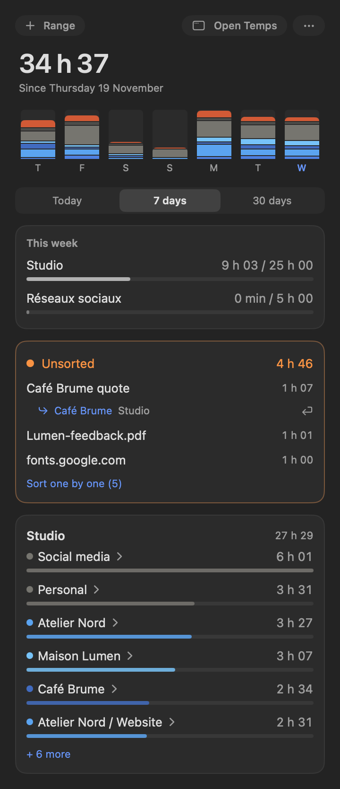
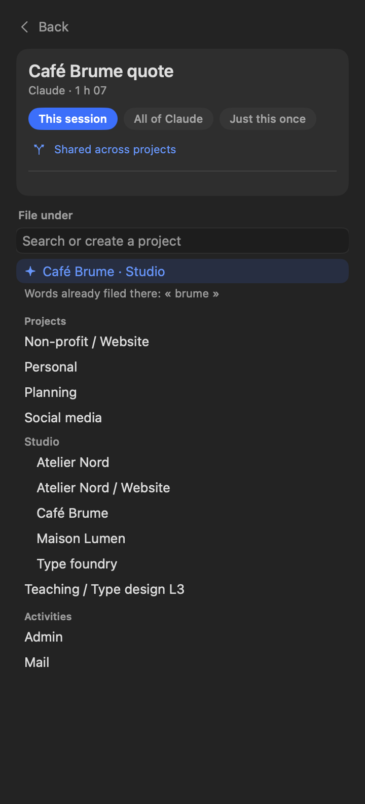
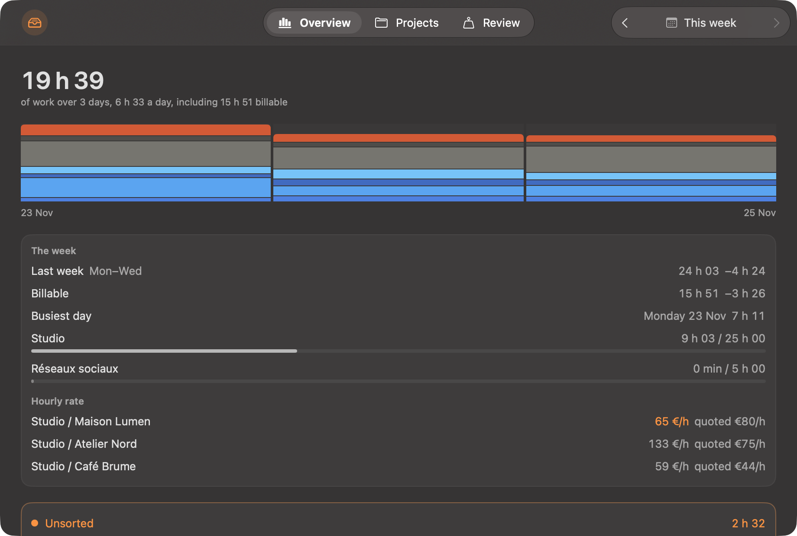
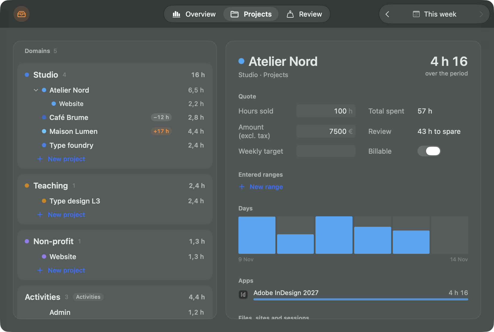
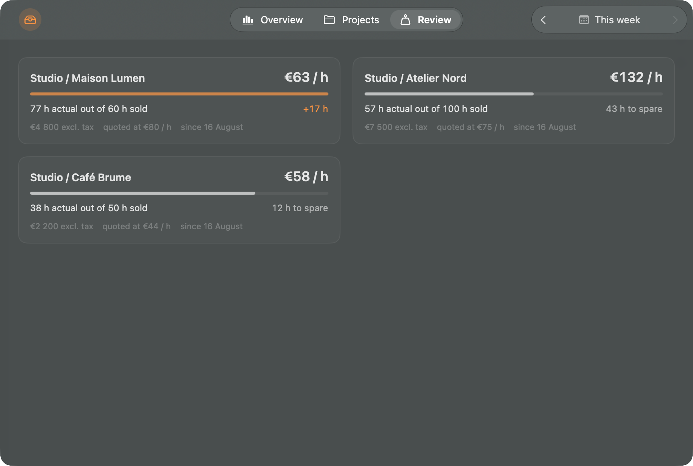

# Temps

**English** · [Français](README.fr.md)

Temps is a small macOS app that watches what your Mac is doing (the app in front, the open file, the website, the work session) and works out how much time went into each project, with no timer and nothing to type. It also reads iPhone and iPad Screen Time when it is shared with the Mac. Everything stays on your machine.



I built it for my own use as an independent graphic designer: I wanted to know how much time a client really takes, compare it with the quote, and see at a glance where the week went. The idea is that files stored in your project folders sort themselves, and everything else gets sorted in one click, once and for all.

## What you do with it

**In the menu bar**, today's total of work. Click it and a panel shows the day as a ribbon colored by project, where unsorted time appears hatched at the hour it happened. Over 7 days it gives way to the week's bars, over 30 days to a month calendar; click a day to open it. Below come your longest projects, grouped under their domain. Each line opens up on what it is made of: files, websites, messages…

**Sorting what is unsorted.** “Unsorted” time is orange, because it is the one thing to act on. Its card shows the first sources with their suggestion: one click (or Return) accepts it without leaving the panel. Otherwise, click a line to open the Sort screen: choose the scope (this site or the whole domain, this contact or the whole mailbox, the whole app, or just this once, with no rule), then the project, which you can create by typing its name. The details under the line show the window titles, the address and the moments, and the suggestion says where it comes from. It is the same screen wherever you file something: a line in the panel or the window, sorted or not, a slot of the ribbon, a file in a project's sheet. The rule applies to all past time too, and an “Undo” bar stays for a few seconds.



**Shared sources.** A supplier that serves several clients (an online printer, a stock photo site) can be marked as shared: it never gets a rule and takes the project you work on right before and after it. When there is one on a single side only, Temps suggests it without filing anything.

**Suggestions** come from what you have already sorted: a site, a title or a word that almost always leads to the same project. One button accepts them all, and a single undo takes them back. There is no AI involved, it is plain computation on your Mac.

**Unsorted time** has its own card at the top. After a few days away, “Sort one by one” opens the To sort section of the window: lines on the left, longest first, the Sort screen on the right with its suggestion ready. Return accepts it, ⌘→ skips.

**The window** (“Open Temps”) has three views at the top and the period on the right: today, yesterday, a week, a month, a quarter, a year, or dates you pick in the calendar. The arrows move back or forward by a whole period.

**Overview** shows the work of the period day by day, the billable hours, your weekly targets, then one card per domain with its projects.



On a single day, the chart gives way to a ribbon colored by project, with details on hover (clicking a bar of the chart gets you there too). Right-click a piece of the ribbon to file it under another project.

**Projects** sorts everything on three levels: the domain (Studio, Teaching, a non-profit…), the project, and the mission when a client comes back for a new job. A domain has a nature (projects, activities such as mail or admin, off work) and a color, and each of its projects takes a shade of it.

On the left, the list. Create a domain, a project or a mission there, drag a project from one domain to another, double-click to rename. Right-click does the rest: archive a finished project (it leaves the lists, its time still counts), merge two projects, delete.

On the right, the sheet of the selected project. Fill in the hours sold, the amount of the quote, billable or not, and a weekly target if you want one. The review tells you right away whether there is time to spare or you went over. Below comes the detail of the period: days, apps, files, websites and sessions.



A mission can start on a date: from that day on, the project's time goes to it. And when a file or a website landed in the wrong place, “Move”, shown when you hover its line in the sheet, sends it to another project.

For what happens away from the Mac (a meeting, an appointment, an hour of sketching), “+ Range” adds a time range by hand, from the panel or from a project's sheet: the day, start and end times, and a note.

**Review** compares, project by project, actual hours with hours sold, and the actual hourly rate with the quoted one.



**Settings** (⌘,) show whether Temps has its permissions, with a button to each pane of System Settings. They also hold launch at login, a Friday afternoon reminder when more than 2 hours of the week are unsorted, last week's recap on Monday morning, the monthly CSV export for Numbers or Excel, and the list of all your sorting rules, to fix or remove in place. One option files short moments (two minutes or less in the day, with no rule to sort them) with the project around them, when it is there both before and after.

## How Temps counts

- Every 10 seconds it records the app in front, the window title and, whenever the app allows it, the detail of what you are doing there: the open file, the web page, the message you are reading, the selected note or task. Apps that expose neither a file nor a title only show up under their name.
- After two minutes without keyboard or mouse, the whole idle period is removed, unless a video or a call is playing.
- Files stored under a projects root sort themselves: `Studio/Clients/Smith/mockup.indd` becomes “Studio / Smith”. Elsewhere on disk, a folder named after one of your projects is enough. When a project goes by another name than its folder (a client's brand, say), add the client's name under “Also known as” in its sheet.
- iPhone and iPad time comes from synced Screen Time; without a rule it counts as off work. The menu bar figure only counts work.

## Installation

### The easy way: the ready-made app

Download `Temps-1.4-macOS-arm64.zip` from the [Releases](https://github.com/viktorvuka/temps/releases/latest), open it and move `Temps.app` to Applications. It carries everything it needs, Python included: nothing else to install. You need a Mac with Apple silicon (M1 or later) and macOS 14 or later.

The app is not notarized by Apple. On first launch, macOS blocks it: open System Settings > Privacy & Security, scroll down to the message about Temps and click “Open Anyway”. You only do this once. Then follow the first-launch steps below.

### Build it yourself

You need macOS 14 or later, Python 3.11 or later (from [python.org](https://www.python.org/downloads/macos/) or Homebrew), and the Xcode command line tools (`xcode-select --install`).

```bash
git clone https://github.com/viktorvuka/temps.git
cd temps
./macos/build.sh
open Temps.app
```

This builds `Temps.app` in the folder. `./macos/paquet.sh` also builds the ready-made app, with its own Python, in `dist/`.

### On first launch

Temps.app is the interface, and it also runs the background work: the recorder and a small local server on 127.0.0.1:8230.

As long as a permission is missing, the panel opens on the list of the three permissions, with a button to each pane of System Settings; each line turns green once done.

1. In **System Settings > Privacy & Security > Full Disk Access**, add `Temps.app`. Without it, Temps cannot read Screen Time.
2. macOS then asks for **Accessibility** and **Automation** (System Events, Mail, Safari…): accept, this is how Temps reads the file and window in front.
3. For iPhone and iPad, turn on **Share Across Devices** in Screen Time.

For your own build, give it your own identifier: `TEMPS_ID=com.example.temps ./macos/build.sh`. macOS asks for the permissions again after each rebuild. To avoid that, sign the app with a certificate from your keychain (the one Xcode creates for a free Apple ID is enough): `TEMPS_SIGN="Apple Development: …" ./macos/build.sh`.

## Settings

On first launch, Temps creates `rules.toml` from `rules.example.toml`: in `~/Library/Application Support/Temps/` for the ready-made app, next to the code if you built it yourself. The app writes to it when you sort, rename or organize, but you can also read and edit it by hand. Section names are in French (the app was first written in French); the example file explains each one.

| Section | What it does |
|---|---|
| `[dossiers]` | Your projects roots (`racines`), and pass-through folders to skip (`intermediaires`, for example `Clients`). **This is the first thing to set.** |
| `[familles]` | What counts as an activity (`activites`: Mail, Admin…) or as off work (`hors_travail`). Everything else is a project. |
| `[titres]`, `[apps]`, `[chemins]` | Sorting rules: text in a title, URL or address; an app; a path prefix. |
| `[noms]`, `[alias]` | A category's displayed name, and the link when a folder was renamed. |
| `[projets]` | Project sheets: hours sold (`vendu`), amount excl. tax in your Mac's currency (`montant`), billable (`facturable`), other names of the project (`aussi`). |
| `[partages]` | Sources shared across projects: they follow the project around them. |
| `[reperes]` | Weekly targets (`heures`) or caps (`plafond`). |
| `[domaines]` | Domains, in their order: their nature and the projects they hold. |
| `[missions]` | The start date of a mission. |
| `[couleurs]` | The color of a domain. |
| `[archives]`, `[fusions]` | Archived projects, and projects merged into another one. |
| `[forcer]` | A file or website moved by hand: this rule comes before all others. |
| `[reglages]` | Short moments: under how many minutes they are filed with what surrounds them (`lissage`, 0 to turn it off). |

## Shortcuts

While the window is open, Temps has its own menu: ⌘1 to ⌘3 for Overview, Projects and Review, ⌘0 for To sort, ⌘E to export the current month.

## Demo mode

To try the interface without your data, or to take screenshots: quit Temps and reopen it with `open Temps.app --args --demo`. Demo rules live apart and never touch yours. An imaginary studio, three clients and a class fill the screens.

## Privacy

Nothing leaves your Mac. Records live in `~/Library/Application Support/Temps/`, the server only listens on 127.0.0.1 and only answers Temps (a web page open in your browser cannot read anything from it), and there is no account, no telemetry and no third-party service.

## Limits

- Screen Time data comes from internal, undocumented macOS files: a system update can change them.
- The engine is in Python, the interface in SwiftUI: the ready-made app carries its own Python, which makes it heavier (about 20 MB to download). An all-Swift version would be lighter; it does not exist yet.
- It is a first version. I use it every day, and feedback is welcome in the Issues.

## License

GPL v3. You may use, modify and redistribute Temps, as long as modified versions stay free under the same license. See [LICENSE](LICENSE).
