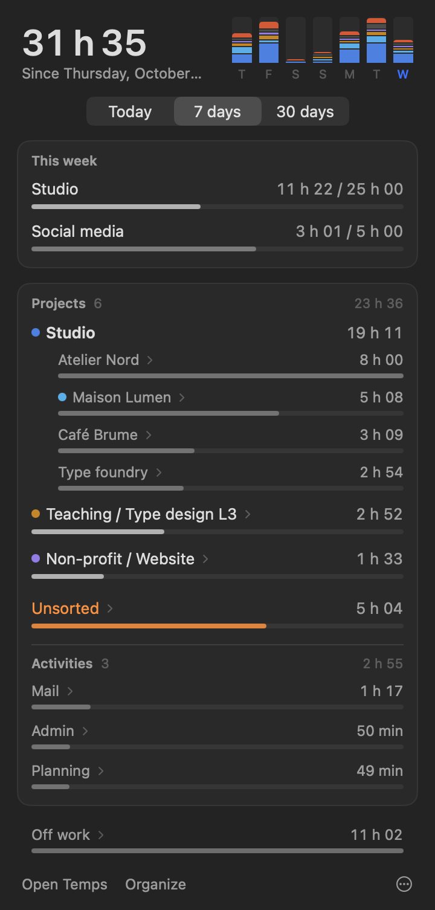
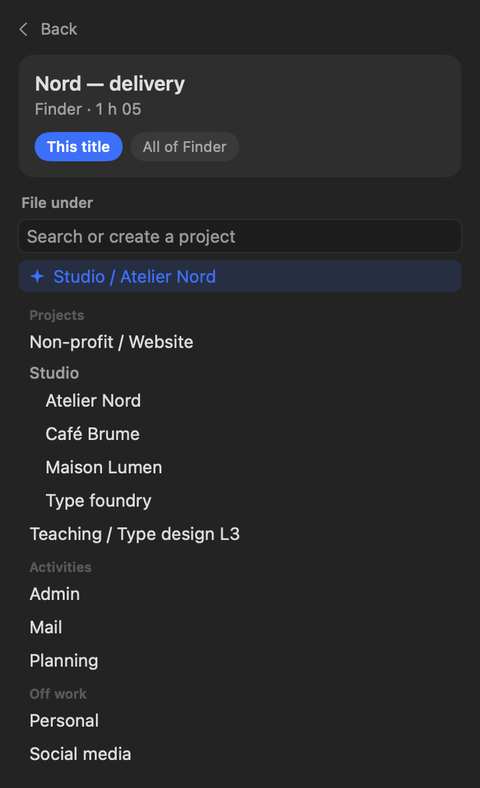
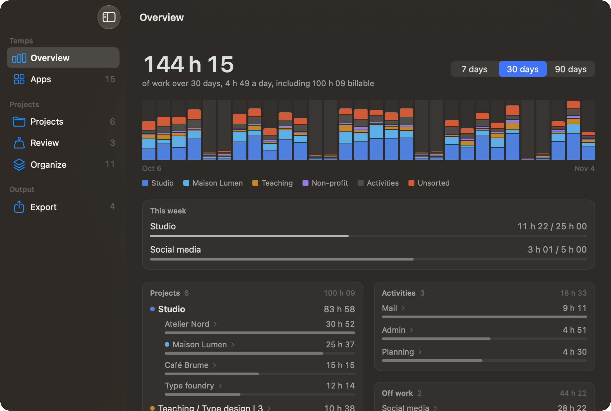
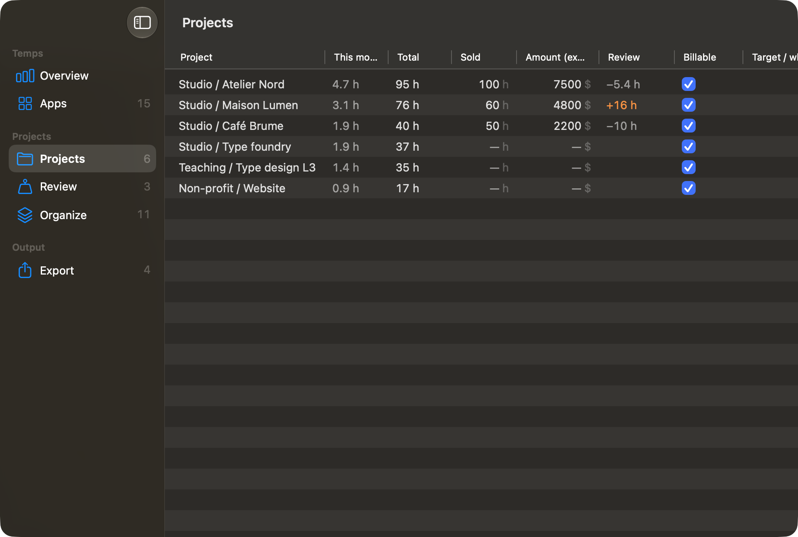

# Temps

**English** · [Français](README.fr.md)

Temps is a small macOS app that watches what your Mac is doing (the app in front, the open file, the website, the work session) and works out how much time went into each project, with no timer and nothing to type. It also reads iPhone and iPad Screen Time when it is shared with the Mac. Everything stays on your machine.



I built it for my own use as an independent graphic designer: I wanted to know how much time a client really takes, compare it with the quote, and see at a glance where the week went. The idea is that files stored in your project folders sort themselves, and everything else gets sorted in one click, once and for all.

## What you do with it

**In the menu bar**, today's total of work. Click it and a panel shows the last seven days as bars colored by project group (click a bar to see that day), your weekly targets, then the time per project. Each line opens up on what it is made of: files, websites, messages…

**Sorting what is unsorted.** “Unsorted” time is orange, because it is the one thing to act on. Click a line to open the Sort screen: choose the scope (this site or the whole domain, this contact or the whole mailbox, the whole app), then the project, which you can create by typing its name. The rule applies to all past time too, and an “Undo” bar stays for a few seconds.



**Suggestions** come from what you have already sorted: a site, a title or a word that almost always leads to the same project. One button accepts them all, and a single undo takes them back. There is no AI involved, it is plain computation on your Mac.

**The window** (“Open Temps”) gives the overview over 7, 30 or 90 days, with the billable hours of the period.



**Projects** is a table you fill in place: hours sold in the quote, amount, billable or not, weekly target. The Review column tells you right away whether there is time to spare or you went over.



**Review** compares, project by project, actual hours with hours sold, and the actual hourly rate with the quoted one.

**Organize** gathers all categories into three families (Projects, Activities, Off work). Drag a category onto a family to move it there, or onto another category to make it a sub-project. Double-click to rename, click a dot to change the color (of a group, or of a single client within its group's shades), and right-click to move under a group or delete.

**Apps** shows the time per application and the category where each one spends most of it. **Export** writes one CSV per month, ready for Numbers or Excel.

## How Temps counts

- Every 10 seconds it records the app in front, the window title and, whenever the app allows it, the detail of what you are doing there: the open file, the web page, the message you are reading, the selected note or task. Apps that expose neither a file nor a title only show up under their name.
- After two minutes without keyboard or mouse, the whole idle period is removed, unless a video or a call is playing.
- Files stored under a projects root sort themselves: `Studio/Clients/Smith/mockup.indd` becomes “Studio / Smith”.
- iPhone and iPad time comes from synced Screen Time; without a rule it counts as off work. The menu bar figure only counts work.

## Installation

You need macOS 14 or later, Python 3.11 or later (from [python.org](https://www.python.org/downloads/macos/) or Homebrew), and the Xcode command line tools (`xcode-select --install`).

```bash
git clone https://github.com/viktorvuka/temps.git
cd temps
./macos/engine/build.sh
./macos/build.sh
open Temps.app
```

This builds two apps in the folder. `Temps Engine.app` does the background work (the recorder and a small local server on 127.0.0.1:8230); `Temps.app` is the interface. On first launch:

1. In **System Settings > Privacy & Security > Full Disk Access**, add `Temps Engine.app`. Without it, Temps cannot read Screen Time.
2. macOS then asks for **Accessibility** and **Automation** (System Events, Mail, Safari…): accept, this is how Temps reads the file and window in front.
3. For iPhone and iPad, turn on **Share Across Devices** in Screen Time.

For your own build, give it your own identifier: `TEMPS_ID=com.example.temps ./macos/build.sh` (same for the engine). Each rebuild of the engine asks for the permissions again; the interface can be rebuilt freely.

## Settings

On first launch, Temps creates `rules.toml` next to the code, from `rules.example.toml`. The app writes to it when you sort, rename or organize, but you can also read and edit it by hand. Section names are in French (the app was first written in French); the example file explains each one.

| Section | What it does |
|---|---|
| `[dossiers]` | Your projects roots (`racines`), and pass-through folders to skip (`intermediaires`, for example `Clients`). **This is the first thing to set.** |
| `[familles]` | What counts as an activity (`activites`: Mail, Admin…) or as off work (`hors_travail`). Everything else is a project. |
| `[titres]`, `[apps]`, `[chemins]` | Sorting rules: text in a title, URL or address; an app; a path prefix. |
| `[noms]`, `[alias]` | A category's displayed name, and the link when a folder was renamed. |
| `[projets]` | Project sheets: hours sold (`vendu`), amount excl. tax in your Mac's currency (`montant`), billable (`facturable`). |
| `[reperes]` | Weekly targets (`heures`) or caps (`plafond`). |
| `[couleurs]` | The color of a group or a sub-project. |

## Shortcuts

While the window is open, Temps has its own menu: ⌘1 to ⌘6 for the sections, ⌃⌘S for the sidebar, ⌘E to export the current month.

## Demo mode

To try the interface without your data, or to take screenshots: quit Temps, run `TEMPS_DEMO=1 TEMPS_LANGUE=en python3 server.py`, then open `Temps.app`. Demo rules live apart and never touch yours. An imaginary studio, three clients and a class fill the screens.

## Privacy

Nothing leaves your Mac. Records live in `~/Library/Application Support/Temps/`, the server only listens on 127.0.0.1, and there is no account, no telemetry and no third-party service.

## Limits

- Screen Time data comes from internal, undocumented macOS files: a system update can change them.
- The engine is in Python, the interface in SwiftUI. An all-Swift version would remove the Python dependency; it does not exist yet.

## License

GPL v3. You may use, modify and redistribute Temps, as long as modified versions stay free under the same license. See [LICENSE](LICENSE).
